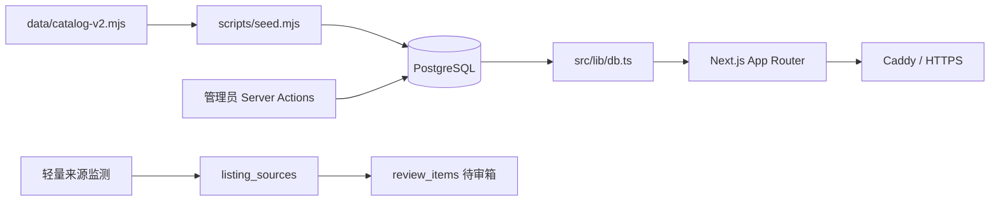

# CCN V2 架构与产品审计

> 审计日期：2026-08-11
> 审计范围：当前仓库、线上首页/目录/详情页、目录数据结构、后台编辑链路、监测与发布流程。
> 重要边界：本报告不把通用文案、受众标签或历史日期当作新的评分事实；没有逐条研究依据的项目保持“未评分”。

CCN 当前已经是一套可部署、可编辑、可监测的 PostgreSQL 内容系统，而不是静态导航页。V2 不应更换技术栈；正确路径是在现有 `listings` 基础上增加类型专属 Profile 和可版本化评分模块，再逐步拆分公开信息架构。

## 快速结论

| 维度 | 当前状态 | Phase 1–2 处理 |
| --- | --- | --- |
| 技术栈 | Next.js 16、React 19、TypeScript Strict、PostgreSQL | 保留 |
| 内容规模 | 70 场比赛、50 项证书、3 个平台 | 保留数量和 Slug |
| 数据模型 | 比赛、证书、平台共用 `listings` | 增加三个类型 Profile |
| 可信度 | 来源、证据、核验日期、待审箱已存在 | 增加 `verified/partial/unverified` |
| 推荐判断 | 只有通用推荐文案，没有结构化评分 | 增加独立 CCN Score 引擎，旧资料不打分 |
| 搜索筛选 | SQL 服务端查询、URL 单值筛选 | Phase 2 保持兼容，Phase 3 后扩展 |
| 普通用户能力 | 无账户、收藏或 AI | 不在本阶段实现 |

## 当前架构

### 请求与数据流



`catalog-v2.mjs` 是目录种子的内容源，`seed.mjs` 将其幂等写入 PostgreSQL。公开页面不直接读取 JSON 或 JavaScript 数据，而是通过服务端 SQL 查询数据库。管理员修改条目后会把 `catalog_managed` 设为 `FALSE`，防止下一次种子导入覆盖人工接管内容。

### 页面与 Router

| 页面 | 作用 | 数据入口 |
| --- | --- | --- |
| `/` | 搜索、近期机会、持续开放、方向索引 | `getHomeData()` |
| `/directory` | 比赛、证书统一目录 | `findListings()` |
| `/directory/[slug]` | 统一详情页 | `getListingBySlug()` |
| `/calendar` | 比赛日期窗口 | `getCalendarData()` |
| `/platforms` | 持续机会平台 | `getPlatforms()` |
| `/about` | 收录、证据与监测政策 | 静态内容 |
| `/admin/*` | 单管理员资料管理与待审 | Server Actions |

根 Layout 统一加载 `SiteHeader`、`SiteFooter`、字体和全局 CSS。当前 Ctrl+K 搜索弹窗最终仍提交到 `/directory`，还不是跨实体的即时搜索。

### 数据结构

`listings` 保存三种实体的公共字段和大量兼容字段；`listing_sources`、`listing_events`、`listing_evidence`、`review_items` 分别负责来源、时间节点、认可证据与官网变化任务。

当前缺少以下结构化事实：

- 比赛的 Build、Benchmark、Hybrid 等类型。
- 个人、在职、学生限定和国际参赛资格的独立状态。
- 证书类型、等级、目标岗位、退役状态和中文考试支持。
- 可版本化的评分输入、总分、等级和评分状态。
- Agent、MCP、RAG、AI Security 等细粒度主题和技术栈。

### 状态与交互

项目没有全局状态库。公开页以 Server Components 和 URL 查询参数为主；客户端状态只用于移动菜单、搜索对话框和后台表单。这个结构适合当前规模，不需要引入新的状态管理依赖。

## 产品发现

### F-001：统一 Listing 无法表达决策差异

- evidence_ids: E-001, E-002
- confidence: high
- finding: `ListingCard` 和统一详情页对比赛、证书、平台使用同一结构，只能显示名称、时间、类别和证据。
- impact: 用户无法在列表阶段判断比赛形态、在职资格、作品复用价值或证书实操性。
- path: 保留 `listings` 公共字段，通过一对一类型 Profile 扩展，不拆表重建全部路由。

### F-002：当前首页还不是机会 Radar

- evidence_ids: E-003, E-004
- confidence: high
- finding: 首屏以 70/50 数量和搜索为核心；线上近期机会为空时，最主要的信息区只显示空状态。
- impact: 用户看见“有多少”，但不能立即得到“现在优先做什么”。
- path: Phase 3–4 使用评分、截止日期、特殊标签和身份字段生成真正的 Radar。

### F-003：现有核验数据不能直接转化为 CCN Score

- evidence_ids: E-004, E-005
- confidence: high
- finding: 123 条资料使用统一目录构造器生成大量通用简介与推荐文案，并集中使用同一核验日期；约 121 条没有确认的报名截止或活动开始时间。
- impact: 如果机械回填分数，会把模板文案伪装成编辑判断，违反“不伪造数据”的原则。
- path: 只迁移安全字段；既有公开资料标记为 `partial`，评分保持 `unrated`。

### F-004：现有可信度基础值得保留

- evidence_ids: E-001, E-006
- confidence: high
- finding: 公开发布已经要求官网、核验日期和至少一项证据；监测器只创建待审任务，不自动修改公开内容。
- impact: V2 可以在可信来源基础上增加编辑评分，而不必重建 CMS 或抓取系统。
- path: 保留来源、证据、事件和待审表；将事实核验与主观评分存入不同字段。

## 保留、修改与新增

| 处理 | 模块 | 原因 |
| --- | --- | --- |
| 保留 | Next.js、PostgreSQL、Zod、Server Actions | 当前基线稳定且符合部署约束 |
| 保留 | 来源、证据、事件、待审箱 | 已形成可信度闭环 |
| 保留 | 旧路由和查询参数 | 避免搜索结果和外部链接失效 |
| 修改 | `listings` | 增加主题、技术、岗位、标签和核验状态 |
| 新增 | Competition Profile | 表达类型、资格、方向指标和评分输入 |
| 新增 | Certification Profile | 表达认证类型、考试、认可度和评分输入 |
| 新增 | Platform Profile | 表达平台方向、活跃度和检查频率 |
| 新增 | Scoring | 权重、版本、分数与等级的唯一计算源 |
| 后续 | `/competitions`、`/certifications`、`/career-paths` | Phase 3 以后基于新数据层实现 |

## 数据迁移路径

### P-001：从统一目录到成长雷达数据层

- path_type: callflow
- start: 现有 `listings` 与 123 个目录 Slug
- goal: 可继续扩展且不伪造分数的 Competition、Certification、Platform 数据层
- steps:
  1. 增量增加公共主题、技术、岗位、特殊标签与核验状态 — evidence: E-001 — finding: F-001
  2. 按 `kind` 创建一对一 Profile，旧主表和旧路由继续可用 — evidence: E-002 — finding: F-001
  3. 只回填 `categories → topics`、费用、有效期等已有事实 — evidence: E-005 — finding: F-003
  4. 满足来源条件的旧公开资料迁移为 `partial`，其余为 `unverified` — evidence: E-006 — finding: F-004
  5. 所有既有条目创建 `unrated` Profile，不生成总分或等级 — evidence: E-004 — finding: F-003
  6. 后台逐条补齐评分输入后，由唯一评分函数生成快照 — evidence: E-001 — finding: F-001
- residual_risks: 现有通用文案仍会保留，需后续 Deep Research 逐条改写；新公开 IA 在 Phase 3 后才能消费全部字段。

## 评分规则

Competition Score 使用方向匹配、简历价值、作品集价值、在职友好、个人友好、项目复用、获奖难度反向值和参与成本反向值。方向匹配指与 CCN 重点技术和岗位方向的相关性，不等于个人职业路线匹配。

Certification Score 使用招聘认可、技术深度、实操性、岗位匹配、生态价值、稀缺度、费用 ROI 和时间 ROI。

所有维度使用 0–5。任一必需维度缺失时不计算。总分映射：S ≥ 90、A ≥ 80、B ≥ 65、C < 65；评分配置分别使用 `competition-v1` 和 `certification-v1` 版本。

## 主要风险

| 风险 | 影响 | 控制措施 |
| --- | --- | --- |
| 旧字段与 Profile 重复 | 编辑时出现不一致 | 公共字段继续归 `listings`，专属字段只写 Profile |
| 未完成评分被误展示 | 产生虚假决策信号 | 缺维度时总分和等级必须为空 |
| 种子覆盖管理员内容 | 人工研究丢失 | 延续 `catalog_managed=FALSE` 所有权规则 |
| 类型切换留下旧 Profile | 数据冗余 | 管理员保存时在同一事务中删除不匹配的 Profile |
| 迁移影响生产 | 服务启动失败 | 增量、幂等迁移；临时数据库先验证；生产前备份 |

## 证据记录

### E-001

- title: 当前技术栈与脚本基线
- observed_at: 2026-08-11
- source_type: file
- source_ref: `package.json`、`src/types/listing.ts`
- content_hash: n/a
- artifact_path: n/a
- repro_command: `Get-Content package.json; Get-Content src/types/listing.ts`
- raw_excerpt: Next.js 16.3、React 19.2、TypeScript Strict、PostgreSQL 驱动、Zod；Listing 只有统一字段。
- linked_workitem: Phase 1
- supersedes: none

### E-002

- title: 当前路由与公共组件
- observed_at: 2026-08-11
- source_type: command
- source_ref: `git ls-files src/app src/components`
- content_hash: n/a
- artifact_path: n/a
- repro_command: `git ls-files src/app src/components`
- raw_excerpt: 公开路由共用 ListingCard 和 `/directory/[slug]` 详情结构。
- linked_workitem: Phase 1
- supersedes: none

### E-003

- title: 线上首页首屏
- observed_at: 2026-08-11
- source_type: network
- source_ref: `https://ccn.cwdzone.top/`
- content_hash: n/a
- artifact_path: n/a
- repro_command: 浏览器访问线上首页，检查桌面与 375px 首屏。
- raw_excerpt: 首屏展示 70/50 数量、搜索和“当前没有已确认的临近截止日期”空状态。
- linked_workitem: Phase 1
- supersedes: none

### E-004

- title: 目录数据完整度统计
- observed_at: 2026-08-11
- source_type: command
- source_ref: `data/catalog-v2.mjs`
- content_hash: n/a
- artifact_path: n/a
- repro_command: `node --input-type=module -e "const {catalog}=await import('./data/catalog-v2.mjs'); console.log(catalog.length)"`
- raw_excerpt: 70 场比赛、50 项证书、3 个平台；约 121 条没有报名截止或活动开始日期。
- linked_workitem: Phase 1
- supersedes: none

### E-005

- title: 目录默认文案构造器
- observed_at: 2026-08-11
- source_type: file
- source_ref: `data/catalog-v2.mjs:70`
- content_hash: n/a
- artifact_path: n/a
- repro_command: `Get-Content data/catalog-v2.mjs -TotalCount 115`
- raw_excerpt: 比赛和证书的简介、认可与推荐可由统一 track 文案自动生成。
- linked_workitem: Phase 1
- supersedes: none

### E-006

- title: 发布门禁与监测隔离
- observed_at: 2026-08-11
- source_type: file
- source_ref: `src/app/admin/actions.ts`、`scripts/monitor-sources.mjs`
- content_hash: n/a
- artifact_path: n/a
- repro_command: `Get-Content src/app/admin/actions.ts; Get-Content scripts/monitor-sources.mjs`
- raw_excerpt: 发布要求核验日期、官网来源和证据；监测变化只写 review_items。
- linked_workitem: Phase 1
- supersedes: none

## 可复现验收

```powershell
npm.cmd run catalog:validate
npm.cmd run score:test
npm.cmd run lint
npm.cmd run typecheck
npm.cmd run build
```

有 PostgreSQL 测试环境时继续执行：

```powershell
npm.cmd run db:migrate
npm.cmd run db:seed
npm.cmd run db:validate
npm.cmd run db:validate-profiles
npm.cmd run db:test-career-radar-migration
npm.cmd run db:test-seed-ownership
npm.cmd run monitor:test
```

## 下一阶段入口

Phase 3 应在本数据层稳定后增加 `/competitions`、`/certifications`、`/platforms` 和 `/career-paths`，同时保留 `/directory` 作为兼容聚合入口。公开 UI 只能展示 `score_status=published` 的分数；`draft` 和 `unrated` 均显示“未评分”。
